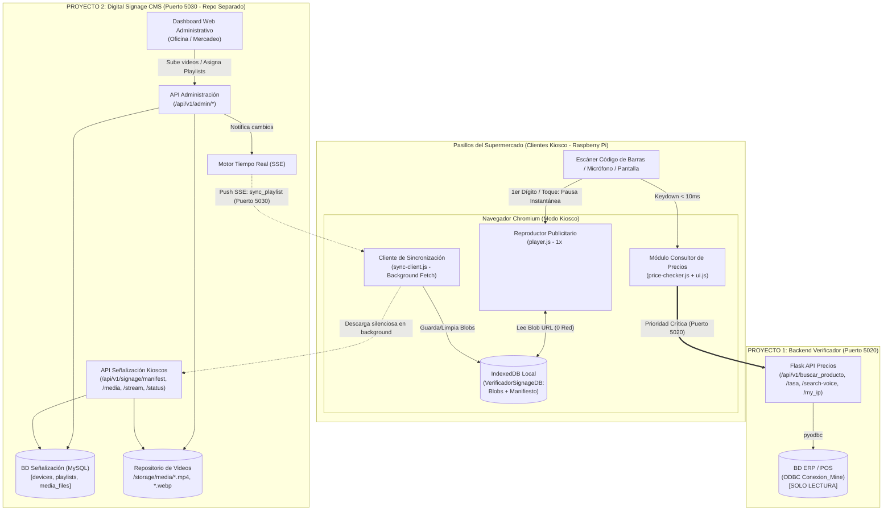
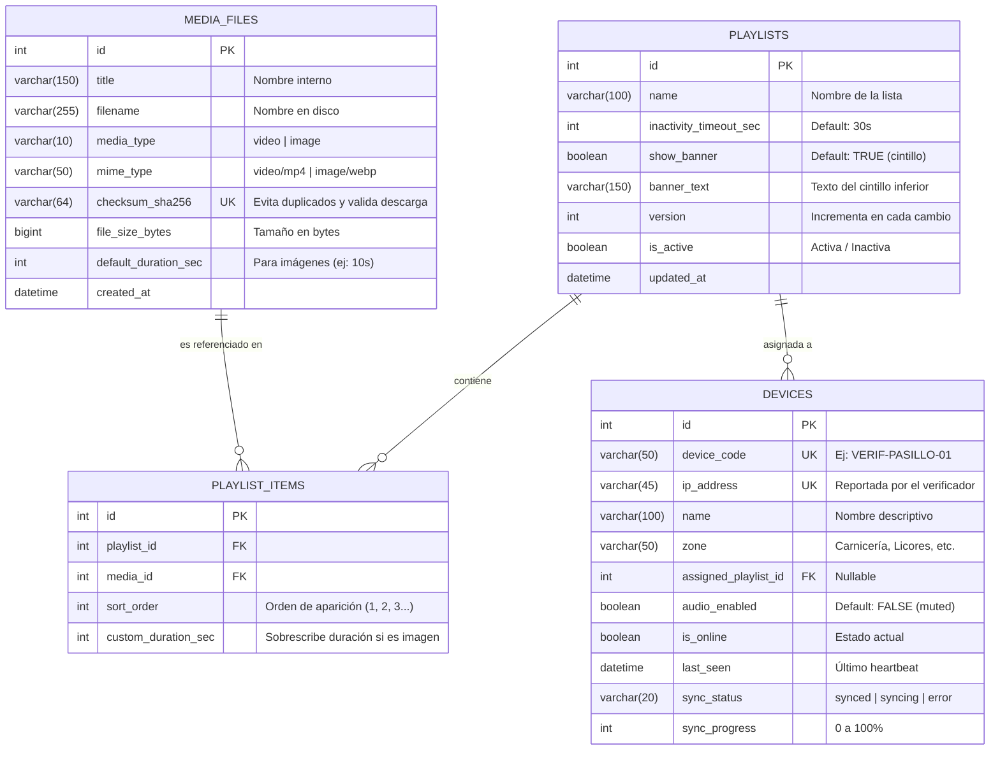
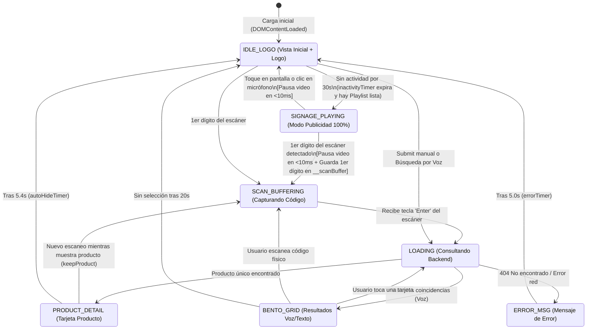

# Documento de Diseño Técnico (TDD): Verificador de Doble Propósito + Señalización Digital (Arquitectura de 2 Repositorios)

Este documento define la planificación de ingeniería bajo una **arquitectura desacoplada en dos proyectos independientes**, garantizando que el servicio crítico de consulta de precios jamás se vea afectado por las operaciones administrativas o la distribución multimedia:

* **Proyecto 1 (`verificadores - flask` — Este Repositorio):** Aplicación de tienda para Raspberry Pi (Consultor de Precios + Reproductor Offline-First con interrupción instantánea `< 10 ms`).
* **Proyecto 2 (`digital-signage-cms` — Repositorio Independiente):** Panel de Control Central (Dashboard Web) + Servidor de Señalización y Sincronización con MySQL.

---

## 1. Arquitectura Técnica Desacoplada

### 1.1 Diagrama de Arquitectura entre Ambos Proyectos



### 1.2 Estructura de Archivos por Repositorio

#### A. Proyecto 1: `verificadores - flask` (Este Repositorio)
El backend de Python permanece 100% dedicado al ERP/POS. Toda la evolución en este repositorio ocurre en el **Frontend del Kiosco**:

```text
verificadores - flask/
├── backend/                           # INTACTO (Solo ERP/ODBC, BCV y Voz)
│   ├── app.py
│   ├── server.py
│   ├── database/
│   ├── routes/
│   └── services/
└── frontend/
    └── src/
        ├── index.html                 # Incluye #signage-overlay fijo (<video> e  únicos)
        ├── css/
        │   └── styles.css             # Estilos para el overlay publicitario y cintillo inferior
        └── js/
            ├── price-checker.js       # Integra timer de inactividad e interrupción <10ms
            └── signage/               # (NUEVO MÓDULO CLIENTE DE SEÑALIZACIÓN)
                ├── signage-manager.js # Orquestador del estado de reposo, timer e interrupción
                ├── storage-idb.js     # Wrapper IndexedDB (Blobs por SHA-256 + Manifiesto)
                ├── player.js          # Reproductor en bucle optimizado para Raspberry Pi
                └── sync-client.js     # Cliente SSE/HTTP hacia el Proyecto 2 (con modo Mock/Local)
```

#### B. Proyecto 2: `digital-signage-cms` (Nuevo Repositorio Independiente)
```text
digital-signage-cms/
├── backend/
│   ├── app.py                         # Servidor en puerto 5030
│   ├── database/
│   │   ├── mysql_client.py            # Conexión MySQL
│   │   └── schema.sql                 # Tablas: devices, playlists, media_files, playlist_items
│   ├── routes/
│   │   ├── signage_kiosk_api.py       # /api/v1/signage/manifest, /media/<id>, /stream, /status
│   │   └── admin_api.py               # CRUD de medios, playlists y asignación de verificadores
│   └── storage/
│       └── media/                     # Archivos físicos (.mp4 H.264 720p, .webp, .png)
└── dashboard-frontend/                # Aplicación Web Administrativa para Mercadeo/Oficina
```

---

## 2. Diseño de Base de Datos

### 2.1 Modelo Entidad-Relación (En Proyecto 2 — MySQL)



### 2.2 Almacenamiento Local en la Raspberry Pi (`IndexedDB` — Proyecto 1)
Base de datos `VerificadorSignageDB` (versión `1`) en el navegador del verificador:
1. **`media_store` (KeyPath: `checksum_sha256`):** Guarda cada archivo binario (`Blob`) indexado por su hash. Evita volver a descargar archivos que se repitan entre playlists.
2. **`config_store` (KeyPath: `key`):** Guarda el manifiesto activo (`active_manifest`) para arrancar sin depender de la red si se reinicia la Raspberry Pi.

---

## 3. Contrato de Comunicación entre Proyecto 1 y Proyecto 2

El verificador (`Proyecto 1`) se comunica con el servidor de señalización (`Proyecto 2`) mediante 3 endpoints públicos de lectura/estado:

### A. `GET /api/v1/signage/manifest?ip=<device_ip>&device_code=<code_optional>`
Devuelve la configuración del dispositivo y la lista de reproducción asignada:
```json
{
  "device": {
    "id": 3,
    "device_code": "VERIF-CARNICERIA-01",
    "name": "Verificador Carnicería",
    "ip_address": "192.168.15.110",
    "audio_enabled": false
  },
  "playlist": {
    "id": 7,
    "name": "Ofertas Carnicería Semana 45",
    "version": 12,
    "inactivity_timeout_sec": 30,
    "show_banner": true,
    "banner_text": "Pase su producto por el lector o toque la pantalla para consultar el precio",
    "items": [
      {
        "sort_order": 1,
        "media_id": 14,
        "title": "Promo Corte Parrillero",
        "media_type": "video",
        "mime_type": "video/mp4",
        "checksum_sha256": "e3b0c44298fc1c149afbf4c8996fb92427ae41e4649b934ca495991b7852b855",
        "file_size_bytes": 8450120,
        "duration_sec": null,
        "download_url": "http://192.168.15.102:5030/api/v1/signage/media/14"
      },
      {
        "sort_order": 2,
        "media_id": 19,
        "title": "Afiche Pollo Entero",
        "media_type": "image",
        "mime_type": "image/webp",
        "checksum_sha256": "8f434346648f6b96df89dda901c5176b10a6d83961dd3c1ac88b59b2dc327aa4",
        "file_size_bytes": 320400,
        "duration_sec": 10,
        "download_url": "http://192.168.15.102:5030/api/v1/signage/media/19"
      }
    ]
  }
}
```

### B. `GET /api/v1/signage/stream?ip=<device_ip>` (Server-Sent Events)
Canal unidireccional ligero que avisa al verificador cuando se publica una nueva lista (`event: sync_playlist`).

### C. `POST /api/v1/signage/status`
Permite al verificador reportar su estado de descarga (`syncing`, `synced`, `error`) y progreso (`0-100%`).

---

## 4. Diagramas Lógicos del Verificador (Proyecto 1)

### 4.1 Máquina de Estados del Verificador



### 4.2 Secuencia de Interrupción Instantánea (< 10 ms)

```mermaid
sequenceDiagram
    autonumber
    actor Cliente as Cliente en Pasillo
    participant Scanner as Escáner USB (Teclado)
    participant Checker as price-checker.js
    participant Signage as signage-manager.js / player.js
    participant API as Flask API Precios (Puerto 5020)

    Note over Checker,Signage: El verificador lleva >30s inactivo: Modo Publicidad Activo
    Signage->>Signage: Reproduciendo Blob desde IndexedDB (100% pantalla)

    Cliente->>Scanner: Pasa producto ("7591234567890" + Enter)
    Scanner->>Checker: Evento keydown (key = '7') [t = 0 ms]
    
    rect rgb(40, 60, 40)
        Note right of Checker: INTERRUPCIÓN INSTANTÁNEA (Síncrona < 5 ms)
        Checker->>Signage: interruptSignage()
        Signage->>Signage: video.pause() + #signage-overlay.classList.add('hidden')
        Checker->>Checker: __scanBuffer = '7' (No se pierde el 1er dígito)
    end

    Scanner->>Checker: Eventos keydown ('5','9','1','2','3','4','5','6','7','8','9','0') [t = 5..60 ms]
    Checker->>Checker: Acumula en __scanBuffer = "7591234567890"

    Scanner->>Checker: Evento keydown (key = 'Enter') [t = 65 ms]
    Checker->>Checker: updateUI({ loading: true })
    Checker->>API: GET /api/v1/buscar_producto/7591234567890
    API-->>Checker: 200 OK (JSON Producto + Precio + BCV)
    Checker->>Checker: updateUI({ product }) (Muestra precio por 5.4s)
```



---

## 5. Decisiones de Diseño Aprobadas
1. **Dos Repositorios Independientes:** Este repositorio (`verificadores - flask`) contiene únicamente el verificador kiosco y su cliente reproductor Offline-First; el CMS/Dashboard de Señalización vivirá en su propio repositorio.
2. **Identificación Híbrida con Auto-Registro:** Por dirección IP detectada en `/api/v1/my_ip` + respaldo opcional por código en URL (`?device=carniceria-01`) o `localStorage`.
3. **Audio Configurable por Dispositivo (`audio_enabled`):** Videos silenciados (`muted = true`) por defecto, con opción de activar audio por verificador desde el Dashboard.
4. **Cintillo Flotante Configurable por Playlist (`show_banner` / `banner_text`):** Barra inferior discreta durante la publicidad invitando al cliente a escanear su producto.
